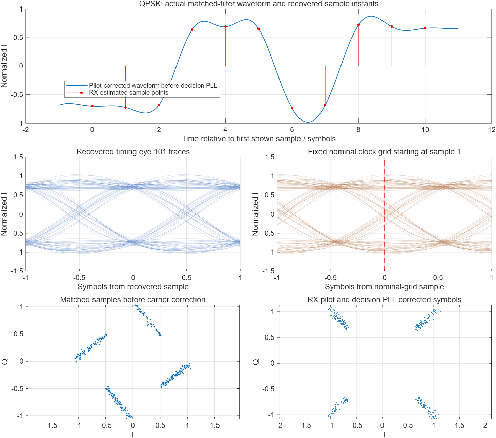
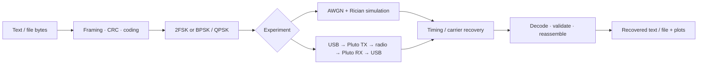

# Pluto Digital Communications Lab

[中文说明](README.zh-CN.md) · [Architecture](docs/architecture.md) · [Hardware setup](docs/hardware.md) · [Tests and results](docs/testing.md)

A MATLAB / Simulink digital communications experiment, from a **2FSK software link** to **BPSK / QPSK transmission between two ADALM-Pluto radios**. It includes editable block models, synchronization receivers, a byte-oriented packet protocol, software validation, and two graphical interfaces for inspecting the signal chain.

The software simulations run on one computer. The demonstrated radio setup uses two Windows computers, each connected to one Pluto through USB. Text and small files travel over the radio link; the receiver decodes its own captured IQ samples.



*Actual output of the public software simulation: recovered sampling instants, eye diagrams, and constellation before/after carrier correction.*

## What is included

| Component | Implementation | What to inspect |
|---|---|---|
| 2FSK simulation | Two complex tones, AWGN + Rician channel, matched energy detectors | Time waveform, soft decisions, recovered symbol timing, CRC-valid text |
| BPSK / QPSK simulation | I/Q mapping, RRC or rectangular pulses, coherent downconversion | Pulse spectrum, eye diagrams, constellations and file recovery |
| Synchronization | FSK transition-driven clock loop; PSK public PN training, clock estimation and carrier tracking | Estimated timing and frequency offset; no transmitted payload is supplied to the decoder |
| Packet transport | Fragment numbering, protected headers, CRC-16, optional SECDED and interleaving, NRZ / Manchester | Text, PNG and PCM WAV bytes reconstructed after channel impairments |
| Pluto hardware | Sample-rate conversion, digital IF, pilot-based coarse frequency tracking, `sdrtx` / `sdrrx` | Real local USB IQ, frame recovery, content display and per-stage plots |
| Desktop interfaces | Simulation dashboard and independent TX/RX terminals | Results gallery, editable payload, receive status and signal-processing steps |
| Validation | Component tests, complete-link simulations, negative controls and offline radio waveforms | Repeatable checks and explicitly recorded failure cases |



## Requirements

Verified development environment: **MATLAB R2025a Update 1 on Windows**, with Simulink, Communications Toolbox, DSP System Toolbox and Signal Processing Toolbox. The Pluto terminals additionally require **Communications Toolbox Support Package for Analog Devices ADALM-Pluto Radio**; the tested support package was 25.1.0, with the ADI Windows USB driver.

MATLAB and the toolboxes are separately licensed dependencies. This repository contains project source; it does not include their installers or binaries. Linux, macOS and other MATLAB releases have not been validated for this release.

## Quick start: software simulation

Clone the repository, open MATLAB in its root folder, then run:

```matlab
setupLab;
commLabLauncher;
```

`setupLab` builds **two actual Simulink models** from installed library blocks. The dashboard runs 12 demonstrations and displays their results and plots. It does not open a radio or play/record sound. The current interface labels are Chinese; the accompanying English instructions describe each action.

For individual experiments:

```matlab
setupLab;
[out, received, cfg, truth] = runFskExperiment('Hello, radio!');
assert(received.complete);

bytes = unicode2native('Hello / 你好', 'UTF-8').';
[out, received] = runAdvancedExperiment(bytes, struct('modulation','QPSK'));
assert(received.complete && isequal(received.bytes, bytes));
```

For the graphical block diagrams:

```matlab
open_system('stuFskSimulation');
open_system('stuAdvancedSimulation');
```

Double-click the modulation and receive-filter subsystems to see their internal blocks. Timing recovery, packet decoding and reassembly are MATLAB functions called after the Simulink waveform stage; their locations are listed in [Architecture](docs/architecture.md).

## Quick start: two-radio demonstration

The recorded hardware setup used **two ADALM-Pluto modules**, their antennas, USB data cables, a Windows laptop and a Surface Pro 7 with 8 GiB RAM. Each computer ran MATLAB and controlled its own radio. The public application accepts any single locally detected Pluto; no registered serial numbers or computer names are required.

On both computers, follow [Hardware setup](docs/hardware.md), then run:

```matlab
setupLab;
runPlutoTerminal('RX');   % receiving computer
```

On the other computer:

```matlab
setupLab;
runPlutoTerminal('TX');   % transmitting computer
```

Choose the same modulation, start reception, and then send text or a small PNG. QPSK/BPSK payloads are limited to **1,024 bytes** in the demonstration envelope. The 2FSK terminal accepts short text up to **48 UTF-8 bytes**. The default RF setting is **2.405 GHz**, at **1 MS/s**. Use a frequency and power permitted for your test environment; see the documented configuration points before transmitting.

No transmission starts simply by opening a terminal. The computers do not need a network connection for the payload transfer.

## Reproduce checks

```matlab
setupLab;
summary = runPublicChecks;  % software only, including both UI constructors

% Broader 57-condition PSK matrix and component checks:
runAllExtensions(fullfile(pwd, 'results', 'all_extensions'));

% FSK full-link matrix:
validateFskExperiment(fullfile(pwd, 'results', 'fsk_matrix'));
```

Results, generated models and captures stay local and are ignored by Git. Fresh public-release checks and earlier hardware observations are distinguished in [Tests and results](docs/testing.md).

The design prioritizes reliable, inspectable low-rate transmission. Training, headers, coding, guards and repeated playback consume airtime. A successful byte-for-byte PNG transfer does not imply a high-throughput image link or zero raw bit errors.

## Repository map

```text
setupLab.m                 Paths, local cache and model generation
models/                    Text source for both Simulink block models
src/fsk/                   2FSK simulation, framing, timing and tests
src/psk/                   BPSK/QPSK, protocol, coding and offline audio
src/psk/tests/             Protocol and receiver challenge tests
src/ui/                    Simulation dashboard and model callbacks
src/hardware/              Pluto FSK adapter and offline checks
src/hardware/demo/         TX/RX terminal, PSK radio adapter and trace UI
tests/runPublicChecks.m    Public-release software checks
docs/                     Design, setup and measured test scope
results/                  Generated locally; not versioned
```

The hardware folders keep small local copies of the validated FSK and PSK protocol cores so that the radio path can be used independently. Avoid adding unrelated versions of these same-named functions to the MATLAB path.

## License and references

Project source is released under the [MIT License](LICENSE). See [Third-party dependencies and provenance](THIRD_PARTY.md). Course handouts, original course template files, reports, recordings and personal experiment records are not distributed.

- [Analog Devices: ADALM-Pluto](https://www.analog.com/en/resources/evaluation-hardware-and-software/evaluation-boards-kits/ADALM-PLUTO.html)
- [MathWorks: ADALM-Pluto support package](https://www.mathworks.com/hardware-support/adalm-pluto-radio.html)
- [MathWorks: host-radio hardware setup](https://www.mathworks.com/help/comm/plutoradio/ug/manual-host-radio-hardware-setup.html)
