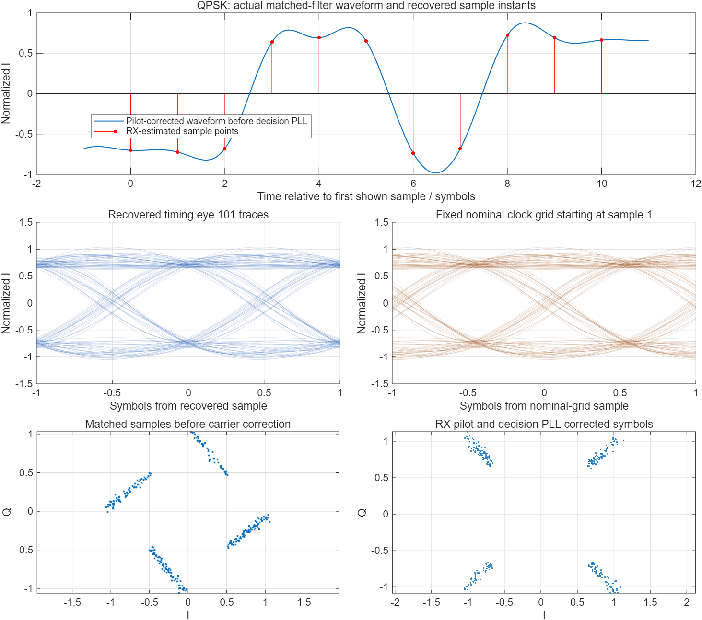

# Pluto 数字通信综合实验

[English](README.md) · [系统结构](docs/architecture.md) · [实物连接与操作](docs/hardware.md) · [测试及结果](docs/testing.md)

本项目从 **2FSK 软件仿真** 扩展到 **BPSK / QPSK 软件仿真与两台 ADALM-Pluto 的实际无线通信**，包含可展开的 Simulink 模型、同步接收机、分片传输协议、两套图形界面及复验程序。

软件仿真在一台电脑上即可运行。实物实验采用两台 Windows 电脑，各通过 USB 控制一台 Pluto。发送内容经过调制和无线信道后，由接收电脑读取本机 Pluto 的 IQ 样本并解码。



图中数据来自公开版实际运行的软件仿真。

## 实验做了什么

| 部分 | 主要内容 |
|---|---|
| 2FSK 基础仿真 | 8/12 kHz 双音调制，AWGN 与莱斯衰落，能量检测，码元时钟恢复，文本分帧与 CRC |
| BPSK / QPSK 扩展 | I/Q 映射、根升余弦与矩形脉冲对照、相干下变频、匹配滤波、训练序列同步、载波跟踪 |
| 编码与传输协议 | NRZ / Manchester、SECDED 单错纠正双错检测、交织、分片编号、帧校验、完整消息重组 |
| 多种载荷 | UTF-8 文本、PNG 图片、PCM WAV 文件；音频接口部分做离线 WAV 验证 |
| Pluto 实物 | 实际插值/抽取、100 kHz 数字中频、双校准音频偏捕获、USB 发射和采样、实际文本与图片接收 |
| 图形界面 | 仿真进度与图集；收发终端的输入、接收状态、频谱、星座及逐步处理图 |
| 验证 | 协议边界与错误拒绝、独立波形、整链路仿真、不同信道与同步条件、静默接收等 |

## 运行环境与设备

- 已验证软件环境：Windows，MATLAB R2025a Update 1，Simulink、Communications Toolbox、DSP System Toolbox、Signal Processing Toolbox。
- 实物另需 ADALM-Pluto 支持包和 ADI Windows USB 驱动，测试使用支持包 25.1.0。
- 实测设备：两台 ADALM-Pluto、配套天线与 USB 数据线，一台 Windows 笔记本和一台 8 GiB 内存的 Surface Pro 7。
- MATLAB 及其工具箱需要单独安装和授权；仓库不包含软件安装包。

## 先运行仿真

下载仓库，在 MATLAB 中把当前文件夹切到仓库根目录，执行：

```matlab
setupLab;
commLabLauncher;
```

第一次运行会从工具箱里的标准模块生成两份真实 Simulink 模型。仿真界面会运行 12 项演示，并显示波形、眼图、星座、频谱和文件恢复结果。这个过程不发射无线信号，也不调用声卡录放音。

单独运行一个链路：

```matlab
[out, rx] = runFskExperiment('Hello, radio!');
bytes = unicode2native('通信测试 / Hello', 'UTF-8').';
[out, rx] = runAdvancedExperiment(bytes, struct('modulation','QPSK'));
```

打开顶层模型：

```matlab
open_system('stuFskSimulation');
open_system('stuAdvancedSimulation');
```

双击调制、检测或匹配滤波子系统可以展开内部连线。码元同步、载波恢复和协议重组在配套 MATLAB 函数中实现，位置见系统结构文档。

## 再运行实物

两台电脑各接一台 Pluto，USB 数据线插在机身的 **USB 三叉图标** 对应接口。Ready 亮灯只表示设备已启动，还需在 MATLAB 中通过 `findPlutoRadio` 确认识别。

接收电脑执行：

```matlab
setupLab;
runPlutoTerminal('RX');
```

发送电脑执行：

```matlab
setupLab;
runPlutoTerminal('TX');
```

两边选择相同调制方式。接收端先点“开始接收”，发送端再输入内容并点“发送内容”。测试图片可点“使用示例图片”。选择文件后请检查发射增益；现有界面会自动把文件模式增益设为 0 dB，可手动调低。

QPSK/BPSK 演示载荷上限为 **1,024 字节**；2FSK 终端限制为 **48 个 UTF-8 字节**的短文本。默认射频中心频率 2.405 GHz，采样率 1 MS/s。发射前应确认测试环境允许使用的频率和功率。完整步骤、连接图和参数位置见 [实物说明](docs/hardware.md)。

公开版不依赖指定电脑名或预登记序列号。每台电脑连接一台设备即可识别；打开界面不会自动发射。载荷传输不需要两台电脑联网。

## 验证与结果

```matlab
setupLab;
summary = runPublicChecks; % 不访问射频或声卡硬件
runAllExtensions(fullfile(pwd,'results','all_extensions'));
validateFskExperiment(fullfile(pwd,'results','fsk_matrix'));
```

软件验证和真实射频实测分别记录。较早的 57 组高级仿真中，35 组基准条件均完成恢复；22 组单遍困难条件有 11 组完整恢复、11 组未完整恢复。这些失败保留为系统边界，不按全部成功描述。公开版重新测试的范围见 [测试说明](docs/testing.md)。

实物已完成 2FSK 文本、BPSK/QPSK 文本与 QPSK 小 PNG 文件传输。部分测试采用水平距离约 3 m、高差约 0.8 m 的桌面/地面摆位；另有近距离桌面图片测试，二者分别记录。

内容完整恢复依靠同步、纠错、校验和重复发送补齐分片。校验通过不意味着无线信道没有误码，也不等于高吞吐率：训练序列、帧头、保护间隔和重复播放均有开销。音频 WAV 的软件测试不等于声卡连线或实时音频无线传输。

## 源码目录

| 目录 | 用途 |
|---|---|
| `models/` | 从标准库块重建两份 Simulink 模型 |
| `src/fsk/` | 2FSK 仿真与接收机 |
| `src/psk/` | BPSK/QPSK、编码协议、文件与离线音频 |
| `src/ui/` | 仿真界面及模型运行回调 |
| `src/hardware/` | Pluto FSK 接入、离线验证 |
| `src/hardware/demo/` | 双端收发界面、PSK 实物接入、全过程图解 |
| `tests/` | 公开版的软件检查入口 |
| `docs/` | 系统设计、操作和验证范围 |

生成的模型、结果、IQ 记录和缓存保存在本地，不会加入版本控制。实物目录保留了小型协议核心副本，方便独立使用；不要把其他旧工程的同名函数混入路径。

源码使用 [MIT 开源许可证](LICENSE)。教师原始讲义及模板、个人报告、证书、录音和原始实测记录不在公开内容中。第三方依赖与来源见 [THIRD_PARTY.md](THIRD_PARTY.md)。
