# Architecture and design choices

## 1. Two execution paths

The software models operate on sampled waveforms inside Simulink. MATLAB prepares the source frames and decodes the logged receive waveform. The hardware terminals instead call MATLAB's Pluto transmit/receive objects; they use the same protocol and receiver concepts with a sample-rate and RF acquisition adapter.

The radio demonstration is a MATLAB function chain. It does not run a hidden Simulink transmitter/receiver model.

```mermaid
flowchart TB
  subgraph SW[Software simulation]
    A[Source bytes] --> B[MATLAB framing / coding]
    B --> C[Simulink modulation and pulse shaping]
    C --> D[AWGN then normalized Rician fading]
    D --> E[Simulink detector or matched filter]
    E --> F[MATLAB timing / carrier / protocol decoder]
  end
  subgraph RF[Two independent radio terminals]
    G[Local text / file] --> H[Protocol + waveform synthesis]
    H --> I[Resampling + digital IF + pilots]
    I --> J[sdrtx / transmitRepeat]
    J --> K[Pluto TX → RF channel → Pluto RX]
    K --> L[sdrrx: local IQ only]
    L --> M[Coarse CFO tracking + downconversion]
    M --> N[Resampling + matched filter + synchronization]
    N --> O[Decode frames / recover bytes]
  end
```

## 2. 2FSK baseline

`fskEncodeText` converts ASCII text into framed bits. Each frame contains a preamble, sync word, header, payload and CRC. Bit 0 selects an 8 kHz complex tone; bit 1 selects a 12 kHz tone. With a 1 kbit/s symbol rate, both tones complete an integer number of cycles per symbol and are orthogonal over the symbol interval.

The receiver's two matched FIR branches measure the tone energies. Their normalized difference `(E1 - E0) / (E1 + E0 + floor)` becomes a soft decision waveform. A transition-driven second-order timing loop in `fskDecodeWave` estimates sample instants. `fskDecodeBits` locates frames, checks CRCs and assembles the text. The timing loop receives the measured waveform, not the transmitter's sampling positions.

| Quantity | Default |
|---|---|
| Sample rate | 100 ksample/s |
| Bit / symbol rate | 1 kbit/s |
| Samples per symbol | 100 |
| Tone frequencies | 8 kHz / 12 kHz |
| Simulink vector size | 2,000 samples (20 ms) |
| Payload per frame | Up to 64 bytes |
| Default frame repetitions | 2 |

The radio adapter interpolates the waveform by 10 to 1 MS/s and moves it to a 100 kHz digital IF. The receive adapter estimates coarse frequency error, removes IF and frequency error, filters and decimates before invoking the FSK core. Overflowed USB frames are discarded; samples on opposite sides of a gap are decoded as separate continuous segments.

## 3. BPSK / QPSK signal chain

The advanced model maps one bit to each BPSK symbol, or two bits to the I/Q components of a QPSK symbol. QPSK uses a `1/sqrt(2)` scale to keep symbol energy normalized. A square-root raised-cosine transmit filter limits bandwidth. An identical receive filter forms the matched pair; rectangular shaping is available as a comparison.

| Quantity | Default |
|---|---|
| Sample / symbol rate | 48 ksample/s / 3 ksymbol/s |
| Samples per symbol | 16 |
| Simulated complex carrier | 8 kHz |
| RRC rolloff / span | 0.5 / 10 symbols |
| Taps per RRC filter | 161 |
| Combined nominal filter delay | 160 samples |
| Public training sequence | 127 symbols per tile |
| Data symbols per tile | 256 |

`advPskFrameBits` inserts public training sequences. `advReceivePsk` searches training correlations, estimates fractional timing and clock error, estimates frequency/phase, and tracks residual carrier phase. `advDecodeBits` then performs protocol decoding. Public training sequences are known at both ends; the payload, transmitter noise seed, injected offsets and exact timing are not receiver inputs.

The default software channel order is AWGN followed by a **single-path Rician channel**. Its delay is 1 ms, K factor 3, maximum Doppler 2 Hz, direct-path Doppler 1 Hz and initial phase 1 rad. Path gain is set to −20 dB with normalization enabled. This is not a multi-path delay-spread model.

## 4. Protocol and recovery

`advProtocolConfig` defines 256-byte fragments, a protected 53-byte header, a 64-bit sync word, CRC-16/CCITT-FALSE, a 16-row interleaver and optional extended Hamming SECDED coding. NRZ and Manchester options expose the rate/bandwidth tradeoff.

- **CRC-16** rejects damaged frames.
- **SECDED** corrects one error and detects two errors within each extended Hamming codeword.
- **Interleaving** spreads a burst across codewords; it does not create a benefit for every random-noise condition.
- **Fragment indices and message identifiers** prevent incomplete or mixed messages from being silently joined.
- **SHA-256** is used as a content identifier and complete-message integrity check. It is not encryption or sender authentication.
- **Repeated frames** allow different valid copies to fill missing fragments. There is no return-channel ACK or adaptive retransmission protocol.

The hardware application adds a self-contained envelope (`demoEnvelope`) with a fresh run marker, content kind, filename, byte count and digest. This metadata travels inside the radio payload. `demoDecode` accepts only IQ samples, a modulation choice and optional display callbacks; it is not given an expected message or a transmitter file path.

## 5. Crossing from software to radios

Independent Pluto oscillators introduce frequency offsets much larger than the narrow software PSK acquisition range. The radio adapter adds two known calibration tones at 150 and 190 kHz, alongside data at a 100 kHz digital IF. `demoTrackCarrier` estimates their common offset over 65.536 ms windows with 32.768 ms spacing, smooths short impulses, and integrates the estimated frequency into a phase correction.

PSK uses the real resampling ratio `125/6` from 48 ksample/s to 1 MS/s, and the reciprocal ratio at reception. After coarse correction, the original PN-based synchronization and residual carrier loop recover the symbols. Calibration tones consume power and occupy additional spectrum; this is a simple laboratory acquisition design, not a bandwidth-optimized air interface.

## 6. Where to read the implementation

| Stage | Source |
|---|---|
| Model graphs | `models/build_fsk_model.m`, `models/build_advanced_model.m` |
| FSK source / receiver | `src/fsk/fskEncodeText.m`, `fskDecodeWave.m`, `fskDecodeBits.m` |
| PSK experiment setup | `src/psk/advExperimentConfig.m`, `advPrepareExperiment.m` |
| PSK synchronization | `src/psk/advPskFrameBits.m`, `advReceivePsk.m` |
| Binary protocol | `src/psk/advEncodeBytes.m`, `advDecodeBits.m` |
| Radio waveforms / receiver | `src/hardware/demo/demoMakeWave.m`, `demoDecode.m`, `demoTrackCarrier.m` |
| Hardware FSK adapter | `src/hardware/plutoFskMakeWave.m`, `plutoFskDecodeIq.m` |
| Simulation UI | `src/ui/commLabLauncher.m`, `runCommLabDemos.m` |
| Radio UI and stage plots | `src/hardware/demo/PlutoTerminal.m`, `DemoTrace.m` |

## 中文要点

仿真由 MATLAB 组帧、Simulink 波形链路和 MATLAB 同步解码三部分组成；实物使用 MATLAB 的 Pluto 收发对象。两者共用协议和接收思路，但实物多了实际变采样、数字中频和独立晶振频偏处理。

2FSK 先比较两路频率能量，再恢复码元时钟。BPSK/QPSK 先匹配滤波，再借助公共训练序列恢复定时和载波。完整恢复依靠有效分片积累；CRC、纠错码和消息摘要各有作用，不能把最终文件完整等同于原始信道零误码。
